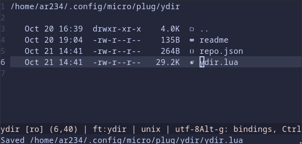

# ydir for micro editor
ydir is a simple and easy to use filemanager

## Highlights
- Good defaults*, easy to configure
- Intuitive Movement with cursor
- Shellmode will execute the command in that directory while in ydir
- Copy/Cut/Paste of files within ydir

## Usage
copy plugin into `.config/micro/plug/ydir/`
restart micro

ctrl+e `ydir tab` to open ydir in a new tab

all possible options:
 - `ydir current` save current buffer and open ydir in it (saving can be disabled)
 - `ydir hsplit` 
 - `ydir vsplit`
 - `ydir tab`

See configure to know how to bind this

## Movement
Cursor movement will traverse in the filesystem
Up/down to scroll through the files
Left/Backspace go to parent directory
Right/Enter open file/directory

Mark and unmark files by indentation (tab-default)

Insert will prompt for file creation
Delete for deletion, needs to be accepted with y for files and yes to recursivly delete directories
for smaller keyboard layouts other keys for these actions need to be binded, see below

## Bindings `~/.config/mirco/bindings.json`
`"F1": "command:ydir",`

all ydir options:
 - `ydir` will open the option set iun ydir.Default (see below)
 - `ydir current` save current buffer and open ydir in it (saving can be disabled)
 - `ydir hsplit` 
 - `ydir vsplit`
 - `ydir tab`

Other commands you can bind to easily:
 - `command:ydir_open_cursor` opens selected file/directory on cursor
 - `command:ydir_back`        opens the parent directory
 - `command:ydir_create`      prompts to create a file or directory
 - `command:ydir_delete`      prompts to delete selected file or directory
 - `command:ydir_mark`        smartly marks files
 - `command:ydir_copy`        copy files
 - `command:ydir_cut`         cut files
 - `command:ydir_paste`       paste files

for easier mouse movement rightclick could be binded `"MouseRight": "lua:ydir.MouseRightClick",`

## Settings `~/.config/mirco/settings.json`
 - `"ydir.Default": "current",`
    Options are: "current", "hsplit", "vsplit", "tab" respectivly

 - `"ydir.SaveBufWhenOpenOnCurrent": true,`
    When opening ydir with current save the buffer before

 - `"ydir.DateSwitchAmount": 15552000,`
    The Dates displayed will switch if they are less then 6 Months(in seconds) old by default

 - `"ydir.HorizontalCursorMovement": false,`
    Disable horizontal cursor movement if you want the horizontal movement for example to select filenames

 - `"ydir.HideDate": false,`
    Hide dates displayed in ydir

 - `"ydir.HideSize": false,`
    Hide size info displayed in ydir

 - `"ydir.HidePermission": false,`
    Hide permissions displayed in ydir

 - `"ydir.Nerdfont": false,`
    If you got a nerdfont installed set this to true if you want to use those icons

 - `"ydir.NerdfontIconSelect": false,`
    Instead of selecting the first character of the file, if set to true will select the nerdfont icon
    
## Contribution
Got ideas or even found a bug, feel free to open an Issue

*mileage may vary; these are my personal defaults
